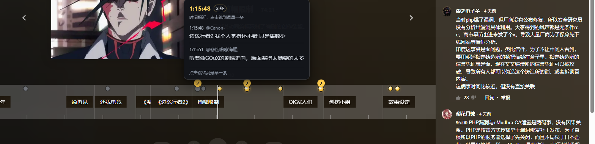
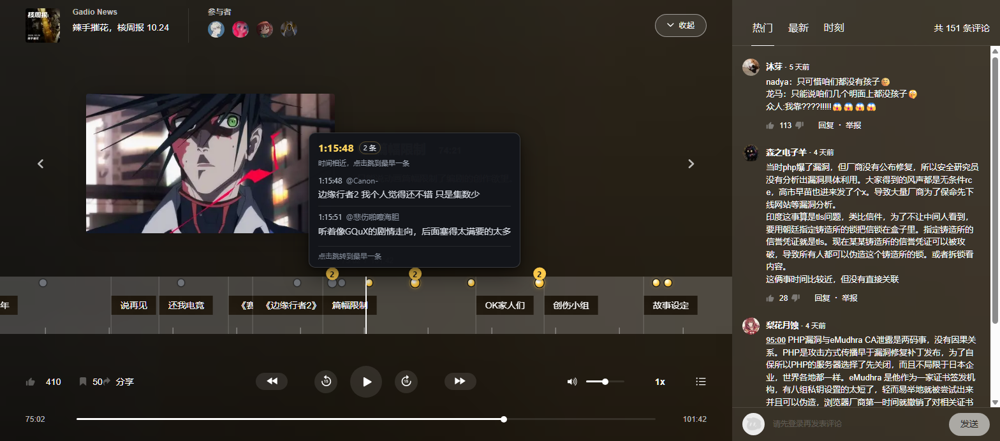

# 机核时间轴评论标记


> 把机核电台「时刻」里的评论，钉到官方时间轴上。

在机核（GCORES）电台页面，带时间戳的评论往往埋在「时刻」列表里，和正在播放的进度对不上。**机核时间轴评论标记**会读取当前节目的这些评论，有官方时间轴时按它的固定刻度落到对应位置，没有官方时间轴时才回退到底部进度条。悬停预览，点击跳转；播放时标记跟着官方时间轴一起滚动。

它只做这一件事：不接管播放器、不改动评论、不上传数据。优先复用页面已加载的评论，缺数据时才请求 `www.gcores.com` 的公开接口；没有评论或请求失败时，原播放器照常使用。安装方式见 [安装](#安装)，完整限制见 [已知限制](#已知限制)。



## 功能

- **官方时间轴优先**：检测 `.playerFullscreenTimelineProgress_bar`，把标记放进它的内部轨道，使用与官方章节相同的“秒 → 像素”比例；播放器滚动、窗口缩放、全屏时仍保持对齐。
- **只标记评论**：官方章节本身已经显示章节标题，扩展不再重复绘制章节点，只显示带 `radio-timestamp` 的评论。
- **固定刻度对齐**：官方时间轴按 100 px / 分钟绘制，轨道尾部还会预留一屏滚动空间；标记按官方像素刻度定位，而不是按整条轨道的百分比，因此播放到后段也不会逐渐偏移。
- **不拦截官方交互**：透明标记层强制 `pointer-events: none`，即使 GCORES 在播放时给轨道子元素写入 `pointer-events: auto`，章节条仍保持手指光标和点击跳转；预览层同样不接收鼠标。
- **无章节条仍用官方时间轴**：没有章节标题但有分钟刻度的节目（例如 221636）把标记放在官方刻度条上；只有页面完全没有官方时间轴，或全屏布局隐藏了它时才回退到底部播放进度条。
- **悬停/聚焦预览**：显示评论时间、作者、正文和“点击跳转到该时间”；同一时间附近的评论合并成一组，显示数量。
- **点击跳转**：直接设置 `audio.currentTime`，**不会调用 `play()`**；暂停时跳转后仍保持暂停。
- **键盘可访问**：标记是原生 `button`，带中文 `aria-label`、可见焦点环，支持 Tab / Enter / Space，Esc 关闭预览。
- **SPA 切换**：监听 history / 页面变化；切换节目时先清空旧标记，再加载新节目，避免旧评论贴到新播放器。
- **完整读取「时刻」评论**：使用页面的 `filter[timed]=1` 过滤接口，每页 100 条，按 `meta.record-count` 继续翻页，不再受原先 300 条上限限制（安全上限 50 页 / 5000 条）。
- **降级提示**：无时间戳评论、接口失败、限流时显示轻量提示，播放器保持可用；失败提示带重试。

- **更大的标记与可读预览**：标记点击区与圆点放大 50%，预览正文使用 14px（与官方章节字体同号），消失时带 150ms 淡出。

## 安装

1. 下载/克隆本目录。
2. 打开 Chrome 的 `chrome://extensions/`。
3. 打开右上角「开发者模式」。
4. 点击「加载已解压的扩展程序」，选择本项目根目录（包含 `manifest.json` 的目录）。
5. 打开任意机核电台节目页，例如：
   <https://www.gcores.com/radios/221016/timelines?pi=1>
6. 播放器加载后，官方章节条顶部会出现黄色评论标记。

> 需要 Chrome 111+（Manifest V3 的 `world: "MAIN"` content script）。

## 使用

- 鼠标移到标记上，或 Tab 聚焦标记，查看评论预览。
- 点击标记 / 按 Enter / 按 Space 跳转到评论时间。
- 同一时间附近的评论会合并成一个带数字的标记；预览会列出组内评论。
- 已播放的标记显示为低饱和灰色，未播放为黄色。
- 官方章节条本身可以横向滚动；标记会跟随章节条一起滚动。

## 数据来源与请求策略

同源接口，不向第三方发送数据：

- 节目信息：
  `GET /gapi/v1/radios/{id}?include=media%2Cmedia.timelines`
- 带时间戳评论（「时刻」标签同款过滤）：
  `GET /gapi/v1/radios/{id}/comments?page[limit]=100&page[offset]={offset}&sort=radio-timestamp&include=user&filter[timed]=1`

实现细节：

- `src/bridge.js` 在 MAIN world 包装 `fetch` / XHR / history，把页面已经请求到的接口响应通过 `gtc:api-data` 事件交给隔离世界，避免重复请求。
- 只有**完整的「时刻」响应**（`filter[timed]=1`、`offset=0`、`data.length >= meta.record-count`）才会被直接复用；普通“热门/最新”评论页只有 10 条，不能代表全部时间戳评论，会被忽略并按需补请求。
- 请求失败重试一次；429/403/404 不盲目重试；单请求 12 秒超时。
- 按 `record-count` 翻页，最多 50 页（5000 条）；正常节目通常 1 页即可。

## 项目结构

```text
manifest.json           MV3 清单
src/bridge.js           MAIN world：接口/路由桥
src/lib.js              纯函数：时间解析、数据提取、合并、分组、无障碍文案
src/content.js          隔离世界：页面适配、数据加载、标记/预览/提示/跳转
src/content.css         命名空间样式（.gtc-*）
tests/lib.test.mjs      Node 单元测试
scripts/                开发用 CDP / 截图 / 大数据量验证脚本
docs/                   README 截图
```

## 测试

```bash
npm test
```

当前结果：**14 个单元测试全部通过**。

浏览器手工/自动化验证过的场景：

- 221636：3 条时间戳评论（0:27 / 11:20 / 44:35），在没有章节标题的官方分钟刻度条上显示标记；悬停预览、点击跳转保持暂停。
- 221016：官方章节条 + 53 个聚合标记；在 75:00 附近可见多个评论标记，章节条滚动后仍对齐。
- 221636 ↔ 221016 SPA 切换：旧标记清空、新标记加载；切回后恢复 53 个。
- 空节目 221625：0 个标记，显示“本节目还没有带时间戳的评论，播放器照常使用。”
- 评论接口失败：0 个标记，显示失败提示和“重试”，播放器仍可操作。
- 窗口缩放至 1024×768、原生全屏：有章节条时标记与章节条精确对齐（实测偏差 < 0.01 px）；全屏页面隐藏章节条时自动回退到全屏进度条，标记不会消失，预览在 fullscreen 顶层可见。
- 官方章节点击：播放中物理点击「Gadio News」仍从 209.2 s 跳到 39.8 s；透明标记层用 `!important` 保持 `pointer-events: none`，不会被 GCORES 播放时写入的 inline auto 覆盖，预览层同样不接收鼠标。
- 点击标记后的预览：标记获得焦点并跳转后，鼠标移开 400 ms 内预览消失；焦点仍在标记上也不会残留。
- 外观 1.1.3：标记点击区 27px、圆点 10.5px（整体放大 50%），分组圆点 13.5px；预览正文 14px，与官方章节标题同号；预览消失时执行 150ms 透明度淡出。
- 大数据量：CDP 模拟「时刻」接口返回 350 条评论（4 页），扩展读取 4 页并渲染 350 条，确认不再截断在 300 条。

## 已知限制

- GCORES 的前端 DOM、接口字段或排序行为变化可能导致失效；选择器尽量以角色/语义和官方时间轴容器为主，但无法保证永久稳定。
- 只支持 `/radios/<id>` 节目页；站外/悬浮 mini player 没有可用的进度条，不显示标记。
- 只展示带有效 `radio-timestamp` 的评论；没有时间戳的普通评论不显示。
- 没有章节标题但保留官方分钟刻度条的节目，标记仍画在刻度条上；只有页面完全没有官方时间轴，或全屏布局隐藏了它时，才回退到进度条。
- 安全上限 50 页 / 5000 条；超过上限的超大节目只加载前 5000 条。
- 章节条是否出现由 GCORES 当前页面决定；页面结构大改时需要更新 `timelineTrackCandidates()`。
- 扩展不修改播放器状态，不自动播放，不写入评论，不上传任何数据。

## 隐私

扩展只在 `https://www.gcores.com/*` 运行，只请求同源 API；没有分析、遥测、远程配置或第三方请求。

## 截图


